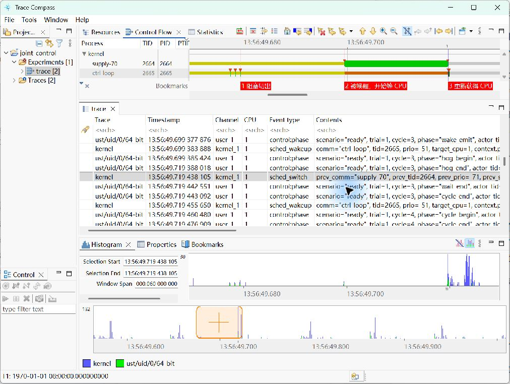

# 在 Trace Compass 中找到阻塞、唤醒和重新运行

本文用 Trace Compass **12.1.0 Windows x86_64** 实际导入仓库里的 CTF，查看同一个 Experiment 的用户态与内核事件。下图是实际工作台截图，三个红色标签是手工添加的 Trace Compass 原生书签；没有重绘状态条或事件数据。

点开原图查看文字。另附[宽屏工作台截图](tracecompass-workbench.jpg)和[原生颜色图例](tracecompass-legend.jpg)。

## 1. 安装与导入

从 [Trace Compass 官方下载页](https://eclipse.dev/tracecompass/download.html)取得与你的桌面系统匹配的包。本次 Windows 12.1.0 包含 Java 21，解压后运行 `tracecompass.exe`，使用独立 workspace。分析现成 CTF 不需要在这台桌面安装 LTTng 内核模块，也不需要 root。

1. `File → New → Tracing Project`，建立项目，例如 `joint-control`。
2. 在左侧 Project Explorer 右击项目的 `Traces → Import…`。
3. 选择 `lttng-test/joint-demo/results/trace` 为根目录，勾选两条自动识别的 trace：`kernel` 和 `ust/uid/0/64-bit`。
4. 勾选 `Create experiment` 后完成导入。在 `Experiments` 下双击新建的 `trace [2]`。

一定同时导入两个域。只打开 UST，只能看到业务事件；只打开 kernel，则缺少场景、次数和周期编号。

## 2. 找到目标周期和线程

打开 `LTTng Kernel` perspective，查看 `Control Flow`。本次界面默认就是这个 perspective；其他布局可从 `Window → Perspective → Open Perspective → Other…` 切换。

先在下方事件表找 `control:phase`。目标载荷为 `scenario="ready", trial=1, cycle=3`，控制线程的 `actor_tid=2665`，辅助线程的 `actor_tid=2664`。这是已保存 trace 的线程号；自己重跑时以新记录为准。

点击 Control Flow 工具栏的 **Show View Filters**。取消全选，仅勾选 `ctrl-loop / 2665` 与 `supply-70 / 2664`，确认。这里筛的是显示行，不是在采集时丢弃其他线程的唤醒事件。

本次桌面时区为 UTC+08:00。在下方 Histogram 的 `Selection Start` 输入 `13:56:49.699383888` 并回车，再把 `Window Span` 设为 `000.060000000`（60 ms）并回车，调整到截图中的区间。其他时区先换算小时：UTC 下是 `05:56:49`，小数部分相同。完整时间还可对照 `results/analysis.json`。

## 3. 顺着三个状态边界读

选中 `ctrl-loop` 一行，在长黄色区间内单击，再点工具栏 **Select Previous State Change** 到区间起点。之后用 **Select Next State Change** 逐个跳到唤醒和再次切入的位置。事件表与选中的时间联动；必要时横向滚动以查看完整 `Contents`。

| 书签 | Trace Compass 显示时间（UTC+08:00） | 应核对的事件载荷 |
|---|---|---|
| 1 阻塞切出 | 13:56:49.679257664 | `sched_switch`: `prev_tid=2665, prev_state=1` |
| 2 被唤醒，开始等 CPU | 13:56:49.699383888 | `sched_wakeup`: `tid=2665, target_cpu=1` |
| 3 重新获得 CPU | 13:56:49.719438105 | `sched_switch`: `prev_tid=2664, next_tid=2665` |

在每个边界点点击 **Add Bookmark**，输入表中的文字，就能复现三个红色标签。书签是本次为讲解添加的界面标记，原始 CTF 不自带这些标签。

点击 **Show Legend** 查看状态颜色。本次默认图例中：黄色为 `Wait blocked`，橙色为 `Wait for CPU`，绿色为 `Usermode`。不要只记颜色，主题变化后以图例文字和事件字段为准。

## 4. 算一次，确认自己看懂了

第一段：`699383888 − 679257664 = 20126224 ns`，阻塞 **20.126224 ms**。

第二段：`719438105 − 699383888 = 20054217 ns`，就绪等待 **20.054217 ms**。

第二段中，控制线程已经醒来，但上方 `supply-70` 仍是运行状态。它与控制线程同绑 CPU 1，FIFO 优先级 70 高于 50；直到辅助线程忙等结束、退出，控制线程才重新运行。事件表还能看到此前的 `wake_emit`、`hog_begin`，以及切入前后的 `hog_end`、`wait_end`，把业务动作与调度状态串起来。

特别注意 `sched_wakeup` 这一行：事件表的 **TID 列可显示 2664**，而 `Contents` 里的目标 **tid 是 2665**。前者是触发事件的执行上下文，后者才是被唤醒的控制线程。把事件表按 TID=2665 全过滤，会漏掉最需要的证据。

绿色表示分析器推导出的线程运行状态，并不证明整个区间逐纳秒都在执行用户代码。本次未采集 IRQ；中断和虚拟化干扰仍可能发生。

## 时间精度与验证范围

上述三个内核边界在本次 Trace Compass 12.1.0 中均比 Babeltrace 2 解码的绝对时间早 5 ns；两段差值完全一致。这里直接记录实际界面值，未推断偏移原因。分析时在同一解码器内相减，不能混用界面值和 JSONL 值来计算纳秒级区间。

本次界面复查日期为 2026-10-19。trace 来自已经保存的 QEMU/KVM / PREEMPT_DYNAMIC 实验，并非新做的 PREEMPT_RT 或硬件实时性测试。6 组原始状态链和丢弃检查见 `joint-demo/results/`；本页截图详细展示 B 的第 1 次、第 3 轮。

官方参考：[内核分析与 Control Flow](https://help.eclipse.org/latest/topic/org.eclipse.tracecompass.doc.user/doc/LTTng-Kernel-Analysis.html)、[导入、Experiment 与时间图操作](https://help.eclipse.org/latest/topic/org.eclipse.tracecompass.doc.user/doc/Trace-Compass-Main-Features.html)。
